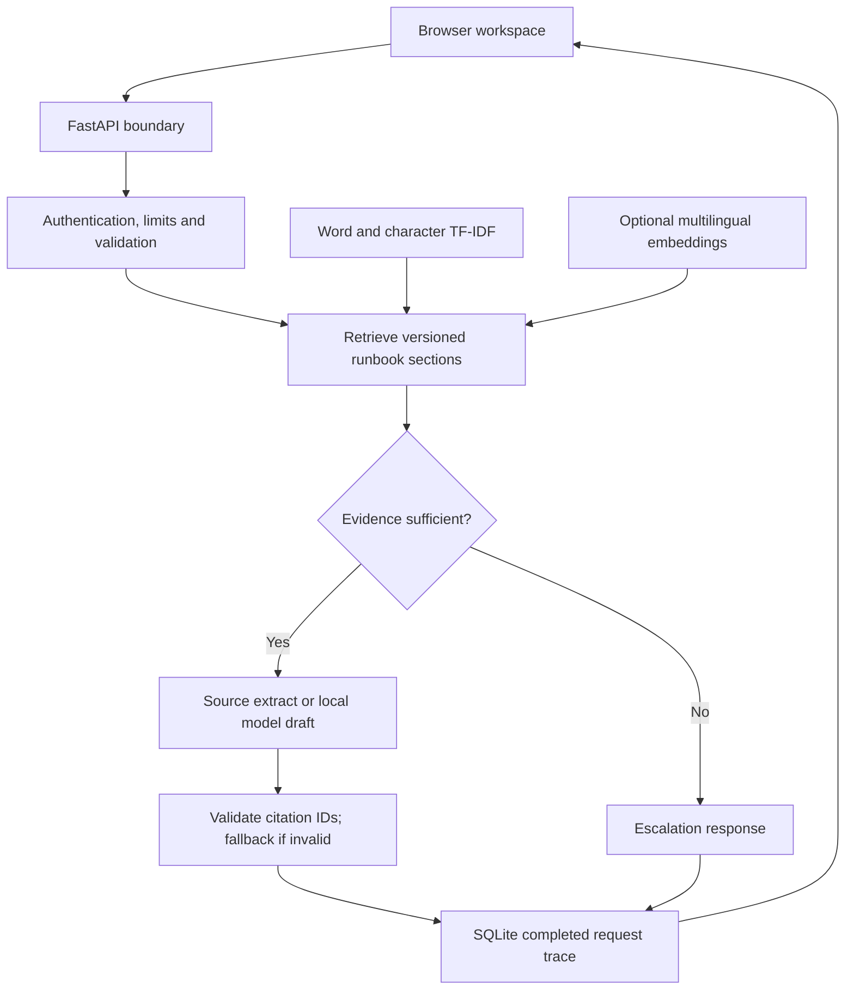

# Architecture and decisions

## Request path

The service never uses model output to execute a command, modify a device or contact another system. Ollama is a drafting backend, not a tool-using agent.

## Ingestion and source identity

At startup, Markdown files are read in filename order. H1 supplies the document title; H2 creates sections. Sections over 1,400 characters split into fixed-size windows. This simple splitter can break sentences in custom long sections; the included corpus fits within section bounds. Each citation ID hashes filename, heading, chunk ordinal and full document SHA-256. The snapshot version hashes sorted filenames and raw bytes. Editing a source changes the snapshot and its citation IDs.

Only direct `.md` children of a configured local directory are ingested. There is no URL fetching or runtime user upload. Content is curated by the deployer and considered untrusted evidence by the drafting prompt. Use a new directory and restart to publish a corpus update. Put unique H2 headings in a document; duplicate headings are rejected to avoid ambiguous citation IDs.

## Retrieval

Baseline lexical similarity is `0.72 * word_cosine + 0.28 * character_cosine`. Word TF-IDF uses unigrams/bigrams and sublinear term frequency. Character TF-IDF uses word-boundary 3–5-grams to tolerate spelling variation. These weights are design choices, not learned or optimized performance claims.

Hybrid retrieval encodes all sections with a pretrained multilingual Sentence Transformer, encodes each incoming query, and computes cosine similarities by normalized dot products. The top 20 lexical and semantic candidates are fused with reciprocal rank fusion: `sum(1 / (60 + rank))`. Filters apply before ranking. The embedding matrix is immutable after startup and neural query encoding is protected with a lock. This trades neural throughput for predictable access on a small CPU instance.

The gate accepts a top hit when lexical similarity is at least 0.12 and content-term coverage is at least 0.20, or semantic similarity is at least 0.48. Coverage excludes a short English/German stop-word list. These development choices are uncalibrated and can accept irrelevant matches. In hybrid mode the similarity gate is applied to the fused top hit; a high-scoring semantic candidate can still be displaced by fusion. Evaluation exposes this behavior.

## Responses

Default output quotes the top supported chunk exactly. Extracts preserve source language. Ollama receives at most five retrieved sections that individually pass the gate. Its JSON response must have a nonempty bounded answer and only evidence IDs supplied in that request. Malformed output, timeout or unknown IDs trigger a source-extract fallback with a reason. Valid IDs do not establish factual support for each sentence. Prompts and pattern filters do not eliminate prompt injection.

## State and deployment

The index is rebuilt at startup; no unsafe pickle/joblib loading. SQLite WAL is the only persistent state. One application worker is supported by the bundled deployment. The body limit buffers at most 16 KiB before validation; question length is 2,000 characters. A per-process sliding window allows 30 protected API calls per peer per minute by default. Inference has four non-blocking slots; excess work gets HTTP 503. None of these controls replaces proxy-level connection, bandwidth or authentication controls.

Completed queries record request ID, timestamp, query SHA-256, decision, latency, backend, actual generation mode, source snapshot, retrieved IDs and fallback reason. They do not record raw query or answer text. Feedback upserts one current vote per request. No user identity is represented. Database failures fail a query rather than claim it was audited. Pre-validation failures and inference exceptions are not persisted as traces; access logs remain separate.

## Why these choices

- One FastAPI process and static frontend keep local and container behavior close.
- A lexical baseline gives a cheap, reproducible comparison against a real neural retriever.
- In-memory exact vector search is appropriate for 32 sections; adding a vector database here would not demonstrate scale by itself.
- Extractive output provides a traceable reference mode for evaluating generation later.
- SQLite avoids an additional service for a single-instance demonstration. Multi-instance deployment needs shared state, identity and rate limiting.
- No arbitrary shell tools or remote ingestion reduce the attack surface of a portfolio deployment.
